# CRT PAL for MPC-HC

I wanted to watch films and anime with the kind of picture I remember from old CRT TVs. A little softer, with clearly visible scanlines, glow around bright objects, a curved screen, and a small frame around the edges. I kept adjusting it until the picture felt right to me.

I already had a Koko-AIO preset in RetroArch on Batocera that I'd spent a long time tuning for games. I wanted to bring that look into MPC-HC for watching videos. That's how CRT PAL started. This version uses native HLSL and a simpler single-pass approach, with softness, scanlines, glow, and reflections tuned for video. The screen curve adapts Koko-AIO's `Warp_koko` function.

MPC-HC's native external shader interface does not expose the full multipass pipeline and previous-frame textures used by the original preset. CRT PAL therefore uses spatial glow and bloom. Temporal phosphor persistence and the complete original effect chain are outside this implementation.

The shader uses straight, adaptive PAL-style scanlines with up to 288 rows, gentle brightness compensation, narrow glow, wider bloom, and highlight roll-off. Horizontal spread alternates two blurred and two clear output pixel rows, independently of the CRT scanlines. Its near radius is 1.5 output pixels, with farther taps at 2.4 pixels. The finished picture receives a 5% brightness gain and a 5% contrast increase around mid-gray.

**View the comparison images at full resolution and 100% zoom. Click each image to open the original PNG.**

## Before and after

### Night on the Galactic Railroad (1985) — official Blu-ray trailer

| No shaders | CRT PAL |
| --- | --- |
| [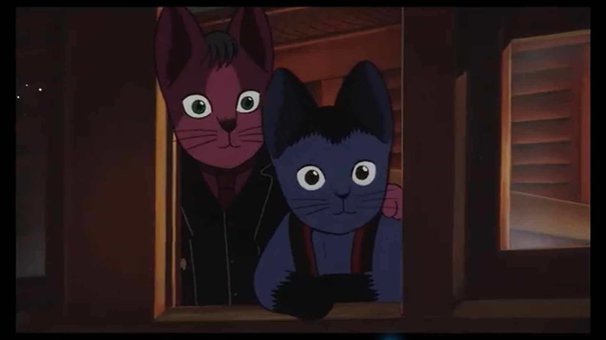](screenshots/galactic-01-no-shaders.png) | [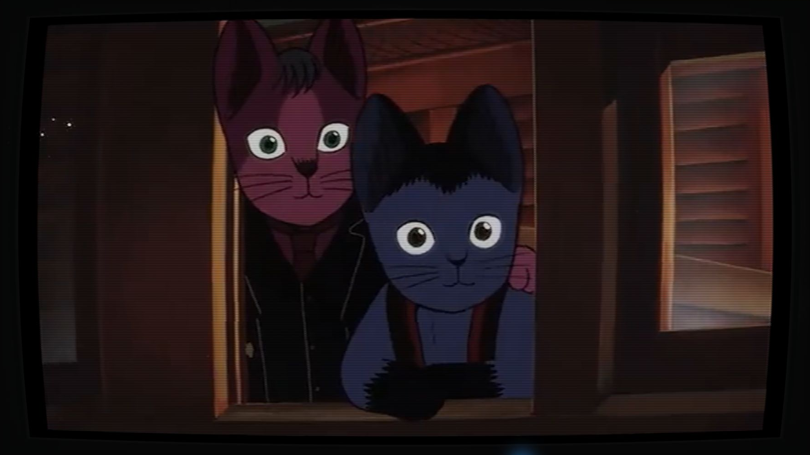](screenshots/galactic-01-crt-pal.png) |
| [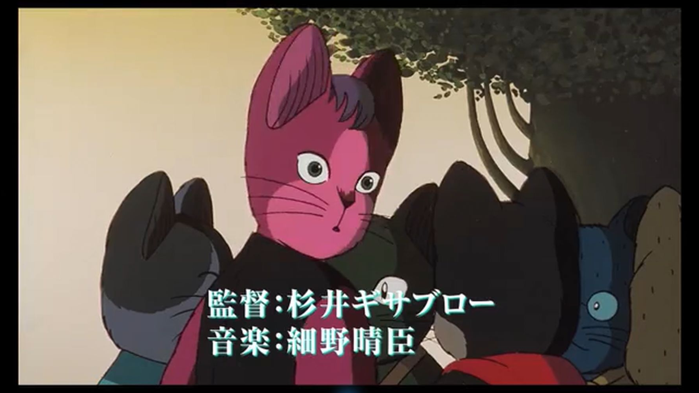](screenshots/galactic-02-no-shaders.png) | [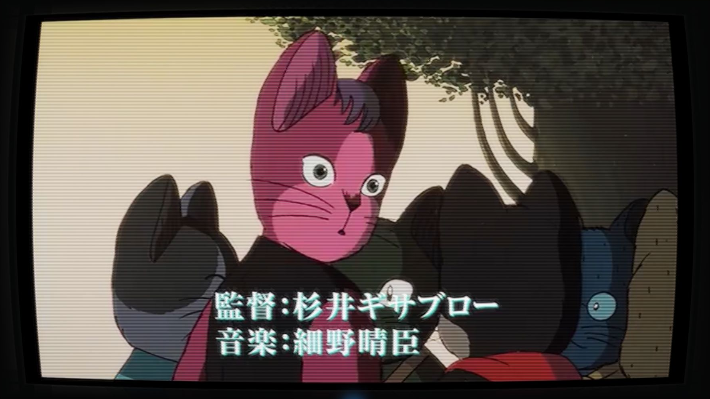](screenshots/galactic-02-crt-pal.png) |
| [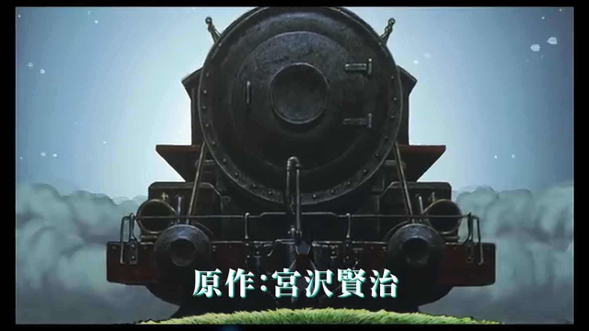](screenshots/galactic-03-no-shaders.png) | [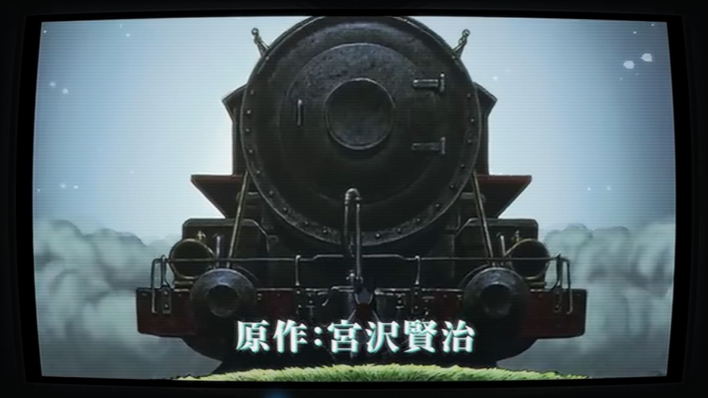](screenshots/galactic-03-crt-pal.png) |

### Doomsday Machine (1972)

| No shaders | CRT PAL |
| --- | --- |
| [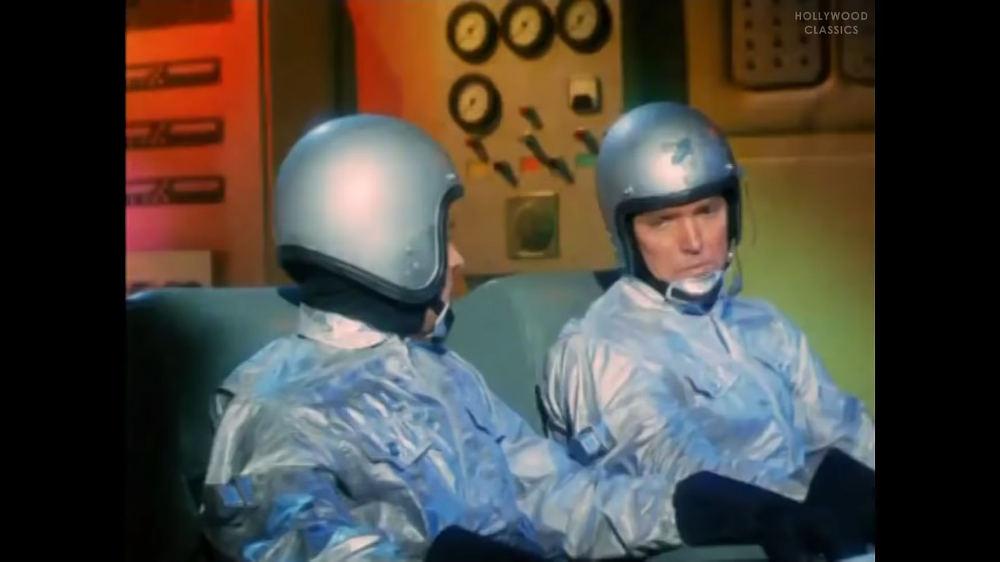](screenshots/doomsday-01-no-shaders.png) | [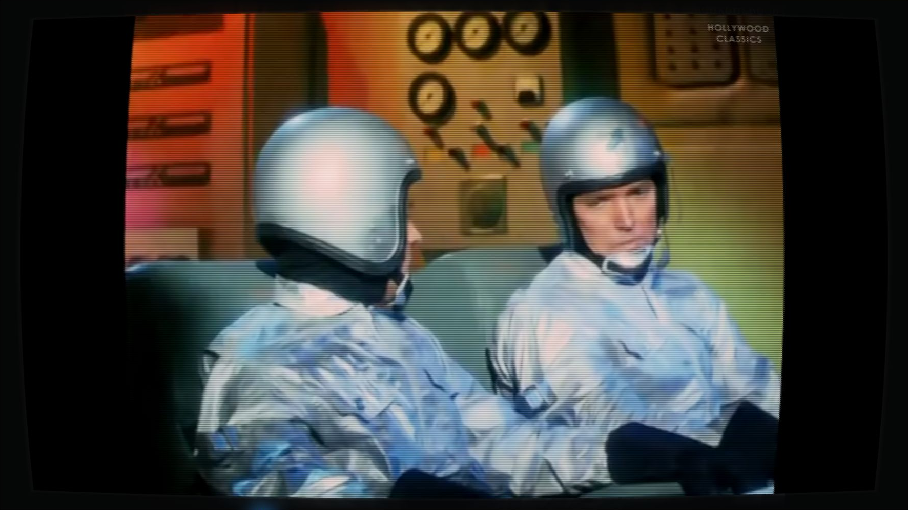](screenshots/doomsday-01-crt-pal.png) |
| [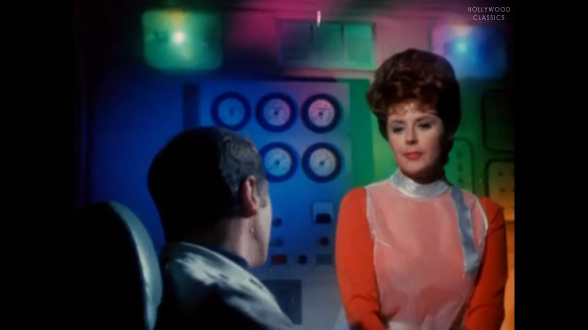](screenshots/doomsday-02-no-shaders.png) | [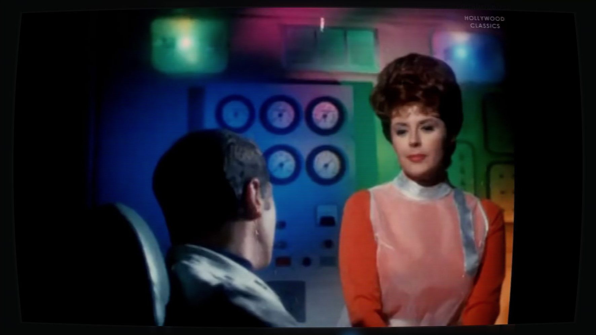](screenshots/doomsday-02-crt-pal.png) |
| [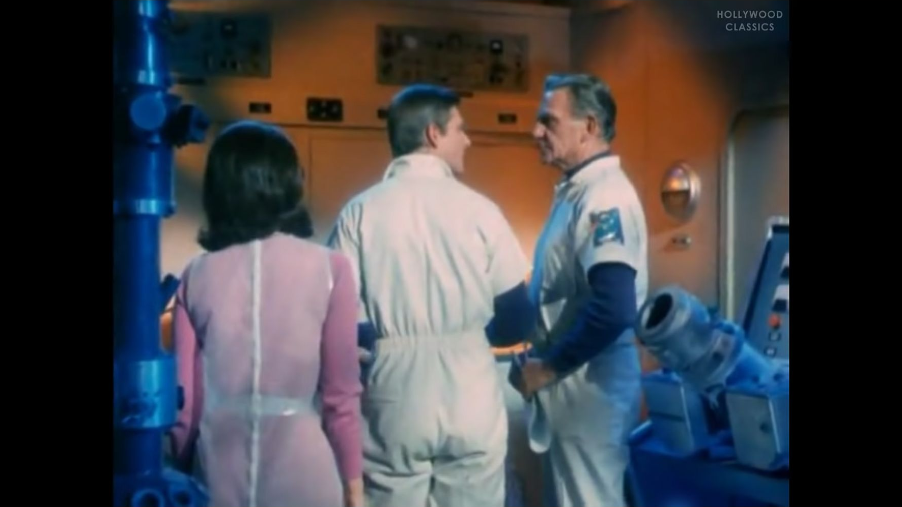](screenshots/doomsday-03-no-shaders.png) | [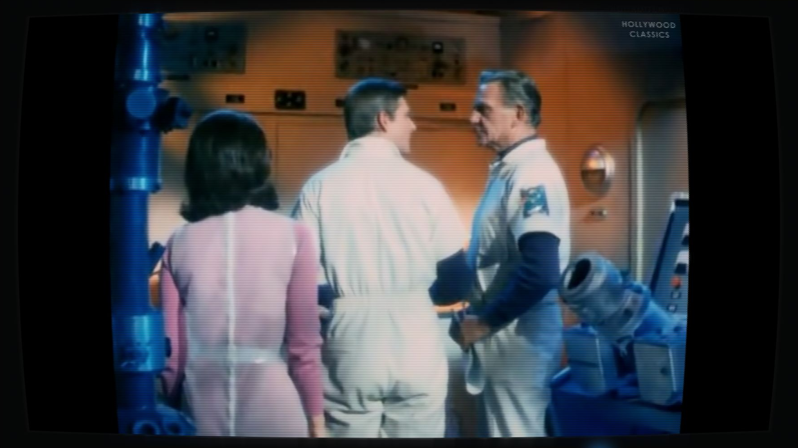](screenshots/doomsday-03-crt-pal.png) |

[Image sources, credits, and reuse terms](THIRD_PARTY_NOTICES.md#example-screenshots).

## Compatibility and requirements

CRT PAL can also be used with other output renderers that provide **MPC-HC-compatible Direct3D 9 HLSL shaders in the post-resize stage**. Compatibility depends on the shader interface and processing stage.

**Supported renderers include MPC Video Renderer in Direct3D 9 mode and madVR through its MPC-HC-compatible Direct3D 9 external shader interface.** MPC Video Renderer was tested during development, and madVR was confirmed working by the project author. See [MPC-HC's external shader integration](https://github.com/clsid2/mpc-hc/blob/develop/src/mpc-hc/MainFrm.cpp).

EVR Custom Presenter and Sync Renderer also provide legacy Direct3D 9 post-resize shader paths. Their compatibility with CRT PAL is inferred from those interfaces and has yet to be visually verified. See the [MPC-HC Direct3D 9 rendering code](https://github.com/clsid2/mpc-hc/blob/develop/src/filters/renderer/VideoRenderers/DX9RenderingEngine.cpp) and [Sync Renderer code](https://github.com/clsid2/mpc-hc/blob/develop/src/filters/renderer/VideoRenderers/SyncRenderer.cpp).

The current source compiles to **508 instruction slots** for `ps_3_0` with the tested Windows SDK compilers, fitting the baseline 512-slot limit. Optimization was compared against the previous shader on the GPU at seven output sizes, from 1×1 to 4K, using gradients and noise patterns.

The requirements are:

- **HLSL pixel shaders compiled as `ps_3_0`**, with a GPU and driver supporting Direct3D 9 Shader Model 3.0.
- **Post-resize processing at the displayed pixel size**, so the two blurred / two clear row pattern stays aligned with output pixels.
- **SDR RGB processing**, with color values in the 0–1 range.
- **The MPC-HC shader bindings**. The input texture is bound at `s0`, its width and height at `c0.xy`, and their reciprocals at `c1.xy`. The shader also uses normalized `TEXCOORD0` coordinates, destination pixel coordinates through `VPOS`, and screen-space derivatives.

The supplied file targets Direct3D 9. A renderer using a Direct3D 11-only external shader path needs a separate port of the shader.

## Manual installation in MPC-HC

This shader was tested for SDR playback in **MPC-HC with MPC Video Renderer in Direct3D 9 mode**.

1. Download [CRT PAL - MPC-HC.hlsl](CRT%20PAL%20-%20MPC-HC.hlsl) and save it in a permanent folder. For example, create `%APPDATA%\MPC-HC\Custom Shaders` and put it there.
2. In MPC-HC, open **Options → Playback → Output** and select a compatible renderer. The tested setup is **MPC Video Renderer** with **Direct3D 9** selected in its settings. Reopen the video if you change the renderer or its Direct3D mode.
3. Open **Options → Playback → Shaders**. Click **Add shader file**, select the downloaded HLSL, then select it in the shader list and click **Add to post-resize**.
4. Type **CRT PAL (Native)** in the **Shader presets** field, click **Save**, then **OK**. You can optionally add MPC-HC's built-in **Adaptive sharpen** immediately before the CRT shader, as used in the screenshots above.

To switch profiles, select one in **Shader presets** and click **Load**, then **OK**. The default **Ctrl+Alt+P** shortcut toggles the full post-resize shader chain.

## License and attribution

The native HLSL source and project-authored documentation are released under [GNU GPL version 3 only](LICENSE). See the [component licenses and attribution](THIRD_PARTY_NOTICES.md) for the reused Koko-AIO geometry and separately installed playback components. The example images have separate reuse terms: the Japanese trailer frames are CC BY 3.0, and the sci-fi source is identified by Wikimedia Commons as public domain in the United States. See the screenshot credits and territorial limitations in the notices; the shader license does not relicense the underlying films.
